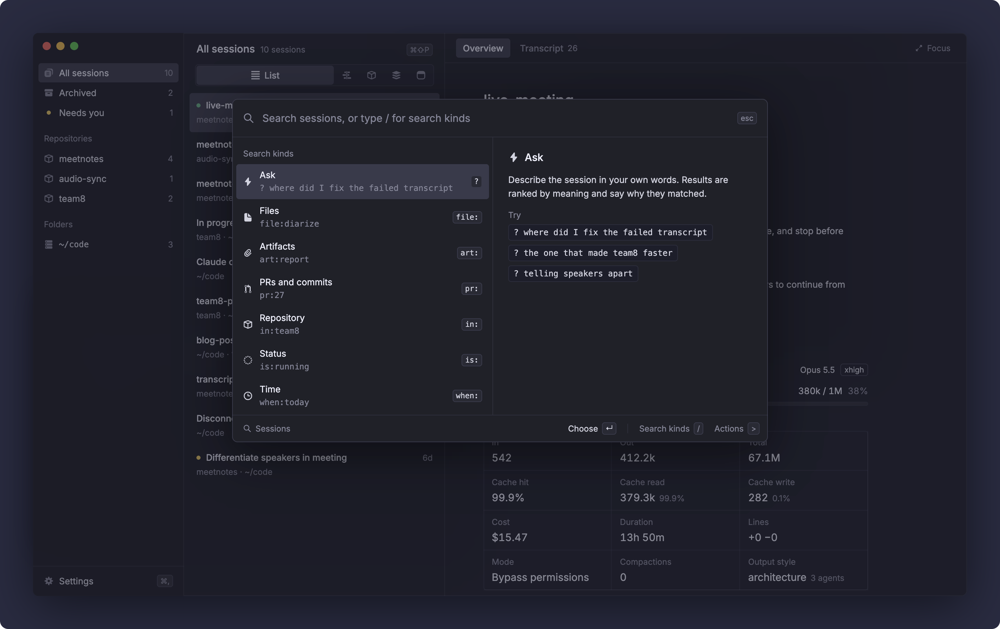

<p align="center">
  
</p>

<h1 align="center">Session Deck</h1>

<p align="center">
  Find, inspect and resume your local Claude Code sessions.<br>
  A macOS app that reads <code>~/.claude</code> and puts every session one keystroke away.
</p>

https://github.com/user-attachments/assets/656fefc1-8bf6-4081-a277-5a589b767a9c

## Why

Claude Code keeps every session on disk, but after a few weeks there are hundreds of them spread across repos, branches and worktrees, most named after their first prompt. Finding "the one where I fixed the transcript upload" means remembering which folder it ran in and scrolling a picker.

Session Deck indexes all of them and lets you look them up by what actually happened in them: the files they changed, the PRs and commits they made, the plans and reports they left behind. Then it opens the one you want in your terminal, in the right folder, ready to continue.

## Search

Press <kbd>⌘</kbd><kbd>⇧</kbd><kbd>P</kbd> anywhere in the app.

The fastest way in is to paste something the session left behind. A PR link like `https://github.com/owner/repo/pull/27` brings up the session that opened it, and the path of a file it wrote or changed, absolute or relative to the repo, brings up the session that touched it. That includes an artifact link like `/Users/you/code/meetnotes/docs/veracity-report.md`, a plan or report you found and forgot which session generated it. No prefix needed.

Plain words search everything. A prefix like `file:` or `pr:` switches to a narrower kind of search and shows up as a chip in the input. Type <kbd>/</kbd> to list every kind with examples.

<p align="center">
  
</p>

| Prefix | Searches | Example |
|---|---|---|
| none | Every word across titles, prompts, recaps, paths, PRs and commits | `speaker diarize` |
| `?` | Your own description of what the session did | `? where did I fix the failed transcript` |
| `file:` | Files the session changed | `file:useVirtualRows` |
| `art:` | Documents the session wrote, by name or content | `art:report` |
| `pr:` | Pull requests and commits | `pr:27` |
| `in:` | One repository or folder | `in:meetnotes live` |
| `is:` | Status, plus hidden and archived sessions | `is:waiting` |
| `when:` | When the session was last active | `when:yesterday` |
| `>` | Actions on the selected session | `> fork` |

Hidden and archived sessions are left out of every search except `is:hidden` and `is:archived`.

### Plain text

With nothing typed, the bar lists the search kinds and your three most recent sessions. Once you type, a session matches when every word shows up somewhere in it, in any order and ignoring case. The words are checked against:

- the title, repository name, branch and folder path (full or with `~`)
- every prompt you sent
- Claude's recap of where it stopped and what's next
- the paths of the files it changed and the names of the documents it wrote
- its PRs (`owner/repo#27`, `#27` or the full URL) and its commits (hash and message)

So `meetnotes#27 4e9c1b7` finds the session that opened that PR and made that commit, a pasted PR link finds the session that opened it, and a pasted path like `docs/plans/sync.md` finds the sessions that wrote or edited that file.

### `?` Ask

For when you remember what a session did but not what it was called. Write it the way you'd say it: `? the one that made team8 faster`.

Filler words (the, where, session, fix, made and so on) are dropped, longer words lose endings like -ing and -ed, and each word left is looked up in the files the session changed, the documents it wrote (their first lines too), its PRs, its prompts, its recap and its title. A session shows up when at least half of the words are found, and sessions with more words found rank higher. Every result has a match score and the reason it matched, like `Changed src/transcribe/diarize.ts`.

Ask is keyword matching for now, not embeddings, so a file name or a word you used in the prompt goes a long way.

### `file:` Files

One row per changed file, with its folder, the session it came from and how many lines it added. Partial names and paths work: `file:diarize`, `file:src/transcribe`, `file:.claude/commands`. With nothing after the prefix you get the files from your most recent sessions first. Results stop at 40 rows.

A change counts when Claude made it with the Edit, MultiEdit or Write tool. Files changed by shell commands, like a `sed` or a formatter run through Bash, aren't tracked.

### `art:` Artifacts

Artifacts are the documents Claude wrote with the Write tool: Markdown, JSON, HTML, CSV, YAML, text and SVG files. Plans, reports, specs, slash commands and configs all end up here, even when the session's name says nothing about them.

`art:` matches the file name, its type, its path and its first 40 lines. `art:veracity` finds a report by a word inside it, and `art:.md` lists every Markdown file. The preview pane shows the start of the highlighted file.

### `pr:` PRs and commits

With nothing typed, it lists every PR your sessions opened. PRs come from the links Claude Code records when a session opens one, and commits from the `git commit` output in the session.

- `pr:27` or `pr:#27` finds PR 27 in any repository.
- `pr:meetnotes` finds PRs in repositories whose name contains it.
- `pr:4e9c1b7` or `pr:stream partial` finds commits by hash or message.
- A pasted link, like `pr:https://github.com/owner/repo/pull/27`, finds exactly that PR, even when the session opened a later one after it.

### `in:` Repository or folder

Start typing a place and the bar suggests repositories and folders with their session counts. Repositories go by name (`in:meetnotes`), and sessions outside a git repository go by folder (`in:~/code`). Once the first word names a place exactly, everything after it is a plain-text search inside that place: `in:meetnotes live speaker`.

### `is:` Status

| Search | Finds |
|---|---|
| `is:running` | Live sessions where Claude is working |
| `is:waiting` | Live sessions blocked on you, like a permission prompt |
| `is:interrupted` | Sessions whose last turn you stopped with <kbd>esc</kbd> |
| `is:failed` | Sessions whose last reply was an API error |
| `is:completed` | Everything else, including live sessions sitting idle at the prompt |
| `is:hidden` | Sessions started from the Agent SDK, which never show in the lists |
| `is:archived` | Sessions you archived |

Typing `is:` alone lists every status with its count.

### `when:` Time

`when:today`, `when:yesterday` and `when:week` (the last seven days), going by each session's last activity in your local time. Typing `when:` alone shows how many sessions fall in each.

### `>` Actions

Runs an action on the session selected in the list, without touching the mouse. Keep typing to filter: `> fork`, `> open pr`.

| Action | What it does |
|---|---|
| Resume | Opens the session in your terminal |
| Copy resume command | Copies `claude --resume <id>` |
| Fork into a new session | Resumes with `--fork-session` and leaves the original as it is |
| Open folder | Opens the session's folder in Finder |
| Open PR | Opens the session's PR in your browser |
| All sessions for PR | Copies `claude --from-pr <number>` |
| Show repo in the tree | Jumps to the session's repository in the sidebar |
| Rename session | Type a new title and press <kbd>↵</kbd> |
| Archive session, Restore from archive | Moves it into or out of Archived |
| Change terminal | Picks the terminal that resumes and forks sessions |
| Show plan usage, Hide plan usage | Wraps your status line so Session Deck can read plan usage, or puts the original back |

The PR actions only show up for sessions that opened one, and Open folder only when the folder still exists.

### Keys

| Key | In the command bar |
|---|---|
| <kbd>↑</kbd> <kbd>↓</kbd> | Move through the results |
| <kbd>↵</kbd> | Resume the highlighted session, run the highlighted action, or pick the highlighted kind or suggestion |
| Click | Select the session and show it in the detail pane |
| <kbd>esc</kbd> | Leave the current kind, then close the bar |
| <kbd>⌫</kbd> | In an empty input, leave the current kind |

The right side of the bar previews the highlighted row: the session's facts and recap, why it matched, or the first lines of an artifact.

## Features

### Browse

- The sidebar has All sessions, Archived and Needs you, then every repository and folder you've run Claude in, ordered by latest activity.
- Branch and worktree chips above the list narrow a repository down. Each row shows its last branch, and clicking it filters to that branch.
- Each row has a status dot: running, waiting, interrupted, failed or completed.
- Needs you only counts live sessions waiting on you and sessions that ended on an API error, so it stays short.

### Inspect

The Overview tab shows where the session stopped and what's next (from Claude's recap), the files it changed, its folder, repository and pull request, and the date Claude Code's cleanup will delete it. Usage covers the context window, tokens, cache hits, cost, duration, lines changed, compactions, sub-agents and permission mode.

The Transcript tab replays the conversation the way the terminal printed it, with tool calls, diffs and expandable output.

### Resume

- Resume opens the session in Terminal, iTerm2, Ghostty, Warp, WezTerm or VS Code, in a new tab or window where the terminal allows it. Until you pick one, it uses the first installed of Ghostty, iTerm2 and Terminal.
- Branch conversation starts a new session from that point with `--fork-session`. The original stays as it is.
- Rename gives a session a real title. It's saved in the transcript as a `custom-title` record, the same one Claude Code writes, so the name shows up there too.
- Archive moves a session out of the lists and search into Archived. Nothing is deleted, `claude --resume` keeps working, and the toast has an Undo.
- Sessions that opened a PR can open it in the browser or copy `claude --from-pr <number>`.

If a terminal can't run the command (VS Code opens the folder only) or fails to open, the resume command is copied to your clipboard instead.

## Getting started

You need:

- macOS on Apple Silicon
- [Claude Code](https://claude.com/claude-code), with at least one session
- Node.js 22 and the Xcode Command Line Tools (`xcode-select --install`) to build the blur addon

```sh
git clone git@github.com:alan-oliv/session-deck.git
cd session-deck
npm install
npm run dev
```

To build the app, set `mac.identity` in [`electron-builder.yml`](electron-builder.yml) to your own signing certificate (`security find-identity -v -p codesigning` lists them), then:

```sh
npm run package
open "dist/mac-arm64/Session Deck.app"
```

The first time you resume in iTerm2 or Terminal, macOS asks whether Session Deck may control it. Allow it, since that's how the command gets typed into a new tab.

## Development

| Command | What it does |
|---|---|
| `npm run dev` | Builds the blur addon and starts the app with hot reload |
| `npm test` | Runs the Vitest suite |
| `npm run typecheck` | Type-checks the main and renderer projects |
| `npm run package` | Builds the signed `.app` into `dist/` |
| `SESSION_DECK_LAUNCH=1 npm test` | Also opens a harmless `echo` in iTerm2, Terminal and Warp |

Tests live next to the code they cover, in `if (import.meta.vitest)` blocks, and are stripped from builds.

### How it works

```
~/.claude/projects/**/*.jsonl ─┐
~/.claude/sessions/*.json     ─┼─▶ main process ──typed IPC──▶ React renderer
~/.claude/session-deck/status ─┘   (indexer, git, terminals)
```

- [`src/main/indexer.ts`](src/main/indexer.ts) watches the transcripts, parses only the bytes appended since the last pass, and caches the result between launches, so a warm start doesn't reread every transcript.
- [`src/main/transcript.ts`](src/main/transcript.ts) turns transcript records into the facts the app shows: prompts, files, commits, PRs, artifacts, usage and the recap.
- [`src/main/terminal.ts`](src/main/terminal.ts) knows how to open each terminal.
- [`src/shared/api.ts`](src/shared/api.ts) is the IPC contract. Adding a method to `Api` without listing it fails the typecheck.
- [`src/renderer`](src/renderer) is the React UI, styled with plain CSS tokens from the Linear Design System (Dark).
- [`docs/design`](docs/design) holds the design handoffs the UI was built from.
