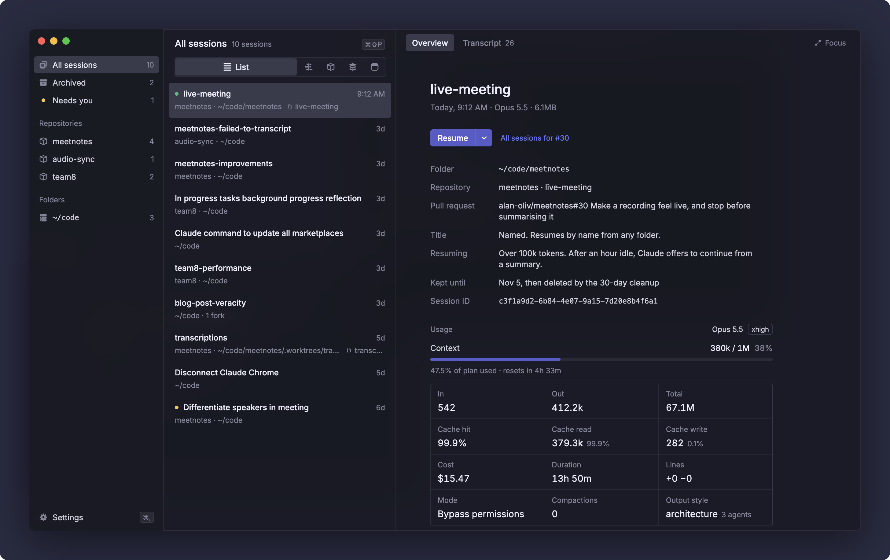

<p align="center">
  
</p>

<h1 align="center">Session Deck</h1>

<p align="center">
  Find, inspect and resume your local Claude Code sessions.<br>
  A macOS app that reads <code>~/.claude</code> and puts every session one keystroke away.
</p>

<p align="center">
  
</p>

<p align="center"><sub>Screenshots use sample data.</sub></p>

## Why

Claude Code keeps every session on disk, but after a few weeks there are hundreds of them spread across repos, branches and worktrees, most named after their first prompt. Finding "the one where I fixed the transcript upload" means remembering which folder it ran in and scrolling a picker.

Session Deck indexes all of them and lets you look them up by what actually happened in them: the files they changed, the PRs and commits they made, the plans and reports they left behind. Then it opens the one you want in your terminal, in the right folder, ready to continue.

## Features

### Browse

- The sidebar has All sessions, Archived and Needs you, then every repository and folder you've run Claude in, ordered by latest activity.
- Branch and worktree chips above the list narrow a repository down. Each row shows its last branch, and clicking it filters to that branch.
- Each row has a status dot: running, waiting, interrupted, failed or completed.
- Needs you only counts live sessions waiting on you and sessions that ended on an API error, so it stays short.

### Inspect

The Overview tab shows where the session stopped and what's next (from Claude's recap), the files it changed, its folder, repository and pull request, and the date Claude Code's cleanup will delete it. Usage covers the context window, tokens, cache hits, cost, duration, lines changed, compactions, sub-agents and permission mode.

The Transcript tab replays the conversation the way the terminal printed it, with tool calls, diffs and expandable output.

### Resume

- Resume opens the session in Terminal, iTerm2, Ghostty, Warp, WezTerm or VS Code, in a new tab or window where the terminal allows it. Until you pick one, it uses the first installed of Ghostty, iTerm2 and Terminal.
- Branch conversation starts a new session from that point with `--fork-session`. The original stays as it is.
- Rename gives a session a real title. It's saved in the transcript as a `custom-title` record, the same one Claude Code writes, so the name shows up there too.
- Archive moves a session out of the lists and search into Archived. Nothing is deleted, `claude --resume` keeps working, and the toast has an Undo.
- Sessions that opened a PR can open it in the browser or copy `claude --from-pr <number>`.

If a terminal can't run the command (VS Code opens the folder only) or fails to open, the resume command is copied to your clipboard instead.

### Command bar

Press <kbd>⌘</kbd><kbd>⇧</kbd><kbd>P</kbd> and type. Type <kbd>/</kbd> to list the search kinds, each with examples.

<p align="center">
  
</p>

| Type | Finds |
|---|---|
| `transcript upload` | Words in titles, prompts, summaries and paths |
| `? where did I fix the failed transcript` | Sessions described in your own words, with the reason each one matched |
| `file:useVirtualRows` | Sessions that changed a file. Partial names and paths work |
| `art:report` | Plans, reports, docs, commands and screenshots a session produced |
| `pr:27` | A PR number or repository, a commit hash or a commit message |
| `in:meetnotes live` | Search inside one repository or folder |
| `is:waiting` | Running, waiting, interrupted, failed, completed, hidden or archived |
| `when:yesterday` | Today, yesterday or this week |
| `> resume` | Actions on the selected session, without leaving the keyboard |

Pasting a GitHub PR link finds the sessions behind that PR.

### Plan usage (optional)

Claude Code only shares plan usage and live context with your status line. Show plan usage wraps your status line command with a small script that saves its input to `~/.claude/session-deck/status/<session>.json` and then runs your original command, so your status line looks the same. It backs up `~/.claude/settings.json` before the change, and Hide plan usage puts your original status line back.

### Look

Pick one of seven accent colors and set the window opacity and the blur behind the window in Settings (<kbd>⌘</kbd><kbd>,</kbd>). The blur comes from a small native addon.

## Privacy

Everything stays on your Mac. Session Deck reads `~/.claude/projects` and `~/.claude/sessions` and makes no network requests.

It writes to `~/.claude` only when you ask it to:

- Rename appends one line to that session's transcript.
- Show plan usage changes `statusLine` in `~/.claude/settings.json`, after a backup.

Its own settings, archive list and index cache live in `~/Library/Application Support/Session Deck`.

## Getting started

You need:

- macOS on Apple Silicon
- [Claude Code](https://claude.com/claude-code), with at least one session
- Node.js 22 and the Xcode Command Line Tools (`xcode-select --install`) to build the blur addon

```sh
git clone git@github.com:alan-oliv/session-deck.git
cd session-deck
npm install
npm run dev
```

To build the app, set `mac.identity` in [`electron-builder.yml`](electron-builder.yml) to your own signing certificate (`security find-identity -v -p codesigning` lists them), then:

```sh
npm run package
open "dist/mac-arm64/Session Deck.app"
```

The first time you resume in iTerm2 or Terminal, macOS asks whether Session Deck may control it. Allow it, since that's how the command gets typed into a new tab.

## Development

| Command | What it does |
|---|---|
| `npm run dev` | Builds the blur addon and starts the app with hot reload |
| `npm test` | Runs the Vitest suite |
| `npm run typecheck` | Type-checks the main and renderer projects |
| `npm run package` | Builds the signed `.app` into `dist/` |
| `SESSION_DECK_LAUNCH=1 npm test` | Also opens a harmless `echo` in iTerm2, Terminal and Warp |

Tests live next to the code they cover, in `if (import.meta.vitest)` blocks, and are stripped from builds.

### How it works

```
~/.claude/projects/**/*.jsonl ─┐
~/.claude/sessions/*.json     ─┼─▶ main process ──typed IPC──▶ React renderer
~/.claude/session-deck/status ─┘   (indexer, git, terminals)
```

- [`src/main/indexer.ts`](src/main/indexer.ts) watches the transcripts, parses only the bytes appended since the last pass, and caches the result between launches, so a warm start doesn't reread every transcript.
- [`src/main/transcript.ts`](src/main/transcript.ts) turns transcript records into the facts the app shows: prompts, files, commits, PRs, artifacts, usage and the recap.
- [`src/main/terminal.ts`](src/main/terminal.ts) knows how to open each terminal.
- [`src/shared/api.ts`](src/shared/api.ts) is the IPC contract. Adding a method to `Api` without listing it fails the typecheck.
- [`src/renderer`](src/renderer) is the React UI, styled with plain CSS tokens from the Linear Design System (Dark).
- [`docs/design`](docs/design) holds the design handoffs the UI was built from.
